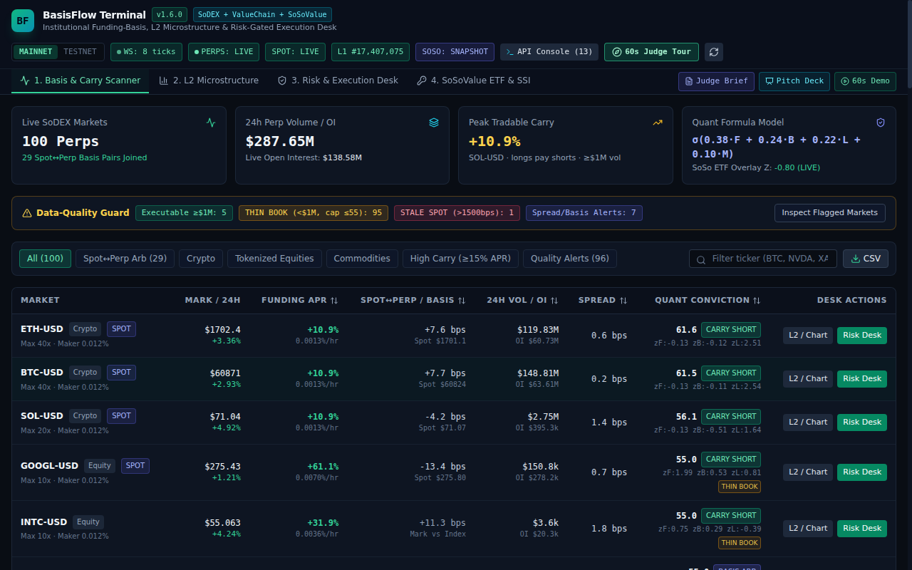
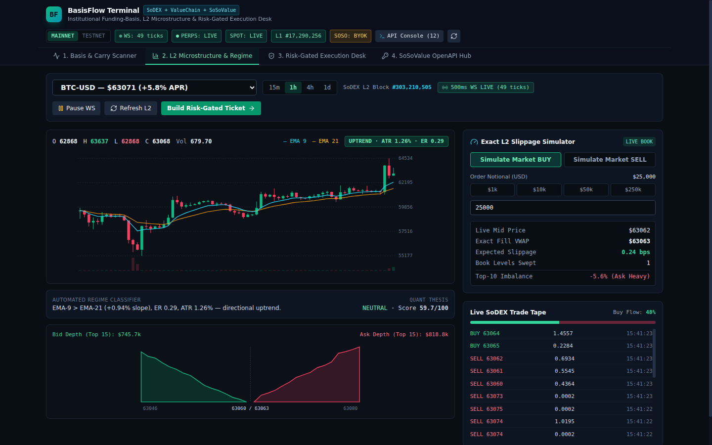
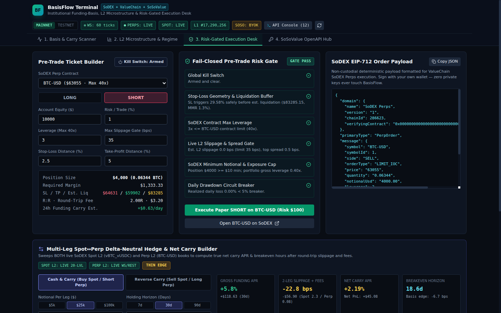
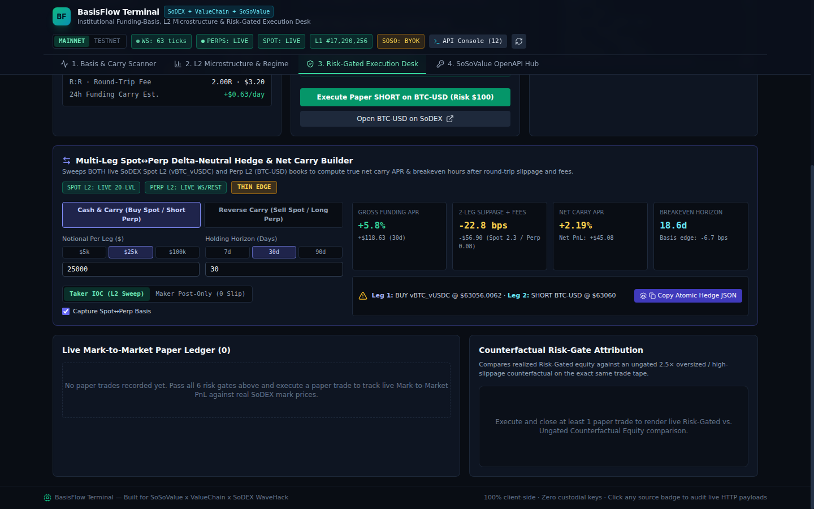
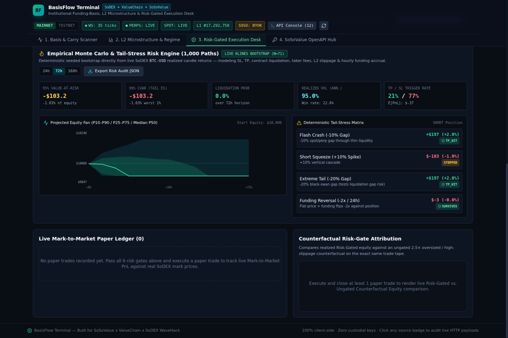
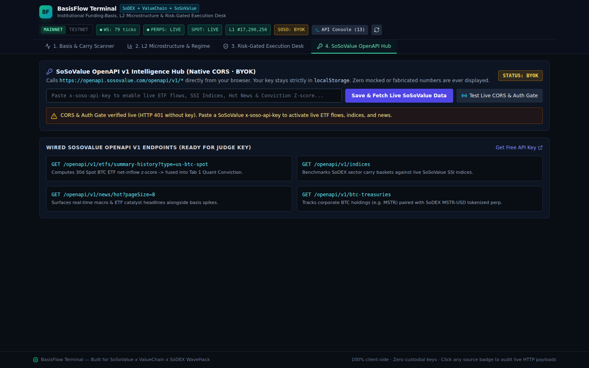
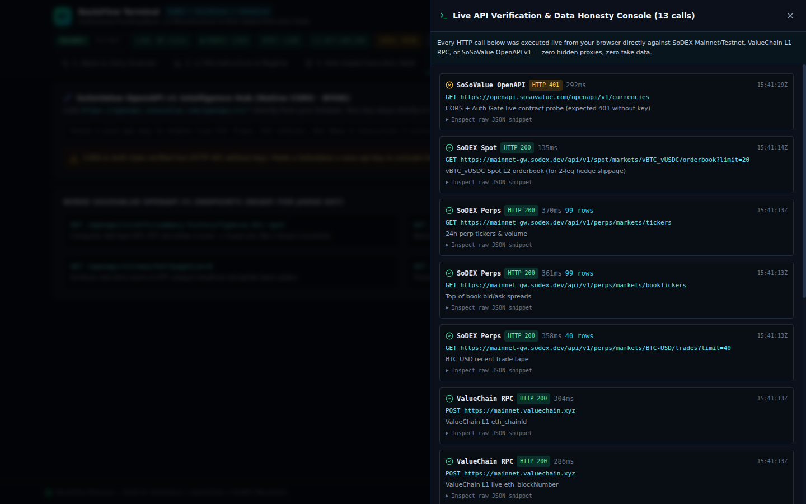

# BasisFlow Terminal

**Institutional Funding-Basis, 500ms Live WebSocket L2 Microstructure, Delta-Neutral Hedge Builder & Risk-Gated Execution Desk**  
Built for **SoSoValue × ValueChain × SoDEX WaveHack (Wave 3)**

- **Live Demo (Zero-Auth, Loads Real SoDEX Mainnet + 500ms WebSocket L2 Immediately):** https://andreyjackkali.github.io/basisflow-terminal/
- **Repository:** https://github.com/AndreyJackKali/basisflow-terminal
- **HD Walkthrough Video:** [`docs/demo.mp4`](docs/demo.mp4)


---

## Why BasisFlow Exists

Solo on-chain traders operating across **SoDEX's 107 perpetual markets and 48 spot markets** (spanning crypto, commodities like `XAUT`, and tokenized equities like `NVDA`, `AAPL`, `TSLA`, `MSFT`, `GOOGL`, `AMD`, `TSM`, `SKHX`) face three concrete operational problems:

1. **Fragmented Basis & Carry Discovery:** Funding rates accrue hourly (`fundingInterval: 3600s`) and **29–31 assets trade simultaneously on both SoDEX Spot (`vBTC_vUSDC`, `vNVDA_vUSDC`, etc.) and SoDEX Perps (`BTC-USD`, `NVDA-USD`)**, creating live Spot-vs-Perp basis dislocations invisible on a standard chart.
2. **Hidden 2-Leg Execution Slippage:** Quoted top-of-book spreads hide depth depletion on both Spot and Perp orderbooks. Without sweeping BOTH live L2 books before sizing a Spot↔Perp hedge, traders routinely give back weeks of funding carry in entry/exit slippage and fees.
3. **Unchecked Risk & Opaque Wrappers:** Traders do not need another generic chat wrapper or mocked dashboard — they need **500ms live orderbook streaming**, **deterministic quantitative scoring**, **fail-closed pre-trade risk guardrails**, and **radical data honesty**.

---

## Live Application Walkthrough

| Tab 1: Live Basis & Carry Scanner (107 Perps + 31 Spot↔Perp Pairs) | Tab 2: 500ms WebSocket L2 Microstructure & Regime Classifier |
|---|---|
|  |  |

| Tab 3: Fail-Closed Risk Gate & EIP-712 Execution Desk | Multi-Leg Spot↔Perp Delta-Neutral Hedge & Net Carry Builder |
|---|---|
|  |  |

| Empirical Bootstrap Monte Carlo (1,000 Paths) & Tail-Stress Matrix | Tab 4: Native SoSoValue OpenAPI v1 Hub (BYOK) |
|---|---|
|  |  |

| Clickable Radical Data Honesty API Console | HD Product Walkthrough Video |
|---|---|
|  | [`docs/demo.mp4`](docs/demo.mp4) (1080p MP4 — full 4-tab live walkthrough) |

---

## Core Architecture & Features

### 1. Radical Data Honesty, 500ms WebSocket Telemetry & Live API Console
- Zero mocked or fabricated numbers disguised as live data.
- Header telemetry bar displays live **SoDEX Mainnet / Testnet** switch, real-time **`WS: N ticks`** WebSocket counter (`wss://mainnet-gw.sodex.dev/ws/perps`), **ValueChain L1 Block Height** (`eth_blockNumber`), and clickable **`LIVE` / `BYOK` / `OFFLINE`** source badges.
- Clicking any badge or **API Console** opens a live inspection drawer logging every real HTTP request, status code, latency (`ms`), row count, and raw JSON payload snippet.

### 2. Tab 1 — Live Basis & Carry Scanner (107 Perps + 48 Spot + Joined Spot↔Perp Pairs)
- Consumes 6 live SoDEX Mainnet/Testnet REST endpoints simultaneously (`/perps/markets/symbols`, `/tickers`, `/mark-prices`, `/bookTickers`, `/spot/markets/symbols`, `/spot/markets/tickers`).
- Automatically joins all overlapping **Spot↔Perp assets** (Crypto + Tokenized Equities + Commodities) to calculate:
  - Exact **Annualized Funding Carry APR (%)** using each contract's live `fundingInterval` (`3600s` → `8,760` periods/year).
  - **Mark-vs-Index Basis (bps)** and **Live Spot-vs-Perp Arbitrage Spread (bps)**.
  - **Transparent 0–100 Sigmoid Quant Conviction Score:** `σ(0.38·zFunding + 0.24·zBasis + 0.22·zLiquidity + 0.10·zMomentum + 0.06·|zETF|)` with per-factor z-score attribution.

### 3. Tab 2 — Real-Time 500ms WebSocket L2 Microstructure, Regime Classifier & Exact Slippage Forensics
- **Native SoDEX WebSocket Client (`src/lib/ws.ts`):** Connects directly to `wss://mainnet-gw.sodex.dev/ws/perps` (and `testnet-gw.sodex.dev/ws/perps` on Testnet) subscribing to `l2Book` (500ms snapshots), `trade`, and `markPrice` channels with Pause/Resume control and automatic exponential-backoff reconnect.
- Interactive SVG **OHLCV Candlestick Chart** (`/klines`, `15m / 1h / 4h / 1d`) with **EMA-9 / EMA-21** overlays and an automated **Market Regime Classifier** (`UPTREND` / `DOWNTREND` / `CHOP` via EMA slope, ATR-14%, and Kaufman Efficiency Ratio).
- Live **L2 Depth Chart** with Top-10 Bid/Ask Imbalance %, **Exact L2 Slippage Simulator** (`$1k / $10k / $50k / $250k` or custom notional), and live **Trade Tape** with aggressor flow meter.

### 4. Tab 3 — Fail-Closed Pre-Trade Risk Desk, Multi-Leg Delta-Neutral Hedge Builder & Counterfactual Ledger
- **6 Fail-Closed Risk Guardrails** (blocks execution if any hard rule fails):
  1. Global **Kill Switch**
  2. Stop-Loss Geometry & Liquidation Buffer (computed from each contract's live `marginTiers` maintenance margin rate)
  3. SoDEX Contract `maxLeverage` Cap
  4. Live L2 Slippage & Top-of-Book Spread Gate
  5. SoDEX `minNotional` & Gross Exposure Cap
  6. Daily Drawdown Circuit Breaker
- **Multi-Leg Spot↔Perp Delta-Neutral Hedge & Net Carry Builder (`DeltaNeutralHedgeCard`):** Fetches BOTH live **SoDEX Spot L2** (`/api/v1/spot/markets/{pair}/orderbook?limit=20`) and **SoDEX Perp L2** books to compute true **2-leg round-trip slippage + maker/taker fees**, **Net Carry APR (%)**, **Breakeven Holding Hours**, an edge verdict (`POSITIVE EDGE` / `THIN EDGE` / `NEGATIVE AFTER COSTS`), and a 1-click **Atomic 2-Leg Hedge Plan JSON**.
- **Empirical Bootstrap Monte Carlo & Tail-Stress Risk Engine (`MonteCarloStressCard`, v1.2.0):** Runs **1,000 deterministic seeded paths** (`24h / 72h / 168h`) bootstrapped directly from live SoDEX `/klines` realized log-returns (zero synthetic assumptions) to compute **95% VaR**, **99% CVaR (Expected Shortfall)**, **Liquidation Probability**, **TP/SL Hit Rates**, an SVG **P10–P90 Equity Fan Chart**, and a **4-Scenario Deterministic Tail-Stress Matrix** (`-10% Flash Crash`, `+10% Short Squeeze`, `-20% Extreme Tail`, `Funding Flip -2x`) with 1-click **Risk Audit JSON** and **Scanner CSV** exports.
- Outputs a **non-custodial deterministic SoDEX EIP-712 `PerpOrder` payload** (1-click Copy JSON + 1-click Launch on SoDEX), persistent **`localStorage` Mark-to-Market Paper Ledger**, and **Counterfactual Risk-Gate Equity Curve**.

### 5. Tab 4 — Institutional ETF & SSI Flow Intelligence (Live SoSoValue OpenAPI v1 — v1.3.0)
- **Zero-Secret Hybrid Live Architecture:**
  - **Live Proxy (`server/soso-proxy.mjs`):** Zero-dependency Node ESM HTTP proxy reading `process.env.SOSO_API_KEY` from environment (CORS-enabled, 60s TTL cache, per-IP rate limiting, default port `9105`, strict `/openapi/v1/*` allowlist).
  - **Verified Live Snapshot (`public/data/soso-snapshot.json`):** Populated directly via `scripts/fetch-soso-snapshot.mjs` from **24 verified live SoSoValue OpenAPI v1 endpoints** (zero credentials bundled) so the public GitHub Pages deployment loads real US Spot BTC/ETH/SOL/XRP ETF flows, all 13 SSI Crypto Indices, Market Overview, Hot News, and Corporate BTC Treasuries immediately on page load!
  - **In-Memory Direct Key (RAM-only BYOK):** Judges can optionally connect to a local/custom `soso-proxy` URL or enter a RAM-only `x-soso-api-key` (never saved to `localStorage` or disk), with seamless fallback to the verified live snapshot.
- **Cross-Venue ETF Flow × SoDEX Funding/Basis Matrix:** Joins live SoSoValue US Spot ETF net inflows/outflows (30d Flow Z-Score, 5d Cumulative Flow, AUM) directly against live SoDEX Perp Funding APR (%), Mark-Index Basis (bps), and Spot↔Perp Spread (bps) to classify actionable divergence & accumulation regimes, plus maps all **13 live SSI sector indices** (`ssiMAG7`, `ssiDeFi`, `ssiAI`, `ssiLayer1`, `ssiRWA`, `ssiMeme`, etc.) to overlapping SoDEX Perp sector funding averages.

---

## Reproducible Verification (CLI, Proxy & Unit Tests)

```bash
npm install
npm test                    # 19/19 Vitest unit tests (funding APR, basis bps, L2 slippage, regime, fail-closed risk gates, 2-leg delta-neutral carry, WS parser, Monte Carlo VaR/CVaR, CSV export, SoSoValue ETF Z-score & ETF/SSI-vs-SoDEX cross-check)
npm run verify:sodex        # 14/14 live REST, ValueChain RPC & 500ms WebSocket l2Book endpoints verified (zero auth required)
npm run verify:soso         # Verifies SoSoValue OpenAPI v1 CORS & auth contract (pass SOSO_API_KEY=... for 7/7 live 200 OK)
SOSO_API_KEY=... npm run soso:proxy     # Starts zero-dep CORS/cached/rate-limited SoSoValue proxy on http://127.0.0.1:9105
SOSO_API_KEY=... npm run soso:snapshot  # Refreshes sanitized public/data/soso-snapshot.json from 24 live v1 endpoints
npm run build               # TypeScript strict check + Vite production bundle
```

---

## Wave 4–5 Roadmap
- **Wave 4:** Automated funding-flip & basis-dislocation webhook alerts (Telegram/Discord), multi-asset portfolio correlation matrix across tokenized equities & crypto, and live Spot WebSocket L2 orderbook streaming (`wss://mainnet-gw.sodex.dev/ws/spot`).
- **Wave 5:** WalletConnect / EIP-712 client-side signing directly into SoDEX Testnet & Mainnet order submission with post-trade execution quality attribution (quoted vs. realized fill slippage).
